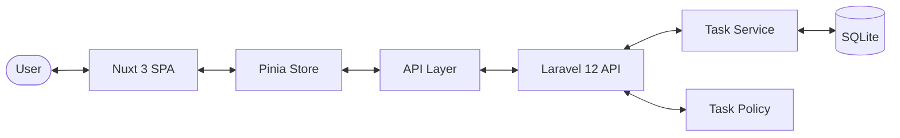

# Requirements

### Overview & Goals
The goal is to build a high-quality, scalable Todo application using Laravel 12 and Nuxt 3. The application will feature a robust backend with Sanctum authentication, a clean service-oriented architecture, and a modern, responsive frontend with optimistic UI updates.

### Scope
- **Backend**: Laravel 12, PHP 8.3, Sanctum, SQLite, Service Layer, Policies, API Resources.
- **Frontend**: Nuxt 3, TypeScript, Pinia, TailwindCSS, Nuxt UI.
- **Infrastructure**: Docker Compose for easy deployment.
- **Features**: Authentication, Task CRUD, Search, Filter, Sort, Pagination, Responsive Design.

### User Stories
- **As a user**, I want to log in securely so that I can manage my personal tasks.
- **As a user**, I want to create, read, update, and delete tasks so that I can keep track of my work.
- **As a user**, I want to search and filter tasks by status or title so that I can quickly find what I need.
- **As a user**, I want to see smooth transitions and loading states (skeletons) so that the app feels fast.
- **As a user**, I want to manage tasks only belonging to me for privacy.

# Technical Design

### Current Implementation
The project is currently empty. We are starting from scratch following modern best practices.

### Key Decisions
- **Service Layer**: Business logic will reside in `TaskService` to keep controllers lean and facilitate testing/reusability.
- **Auth Strategy**: Laravel Sanctum with Bearer Tokens for SPA authentication.
- **UI Library**: **Nuxt UI** will be used for rapid development and consistent design, as it's built specifically for Nuxt 3.
- **State Management**: **Pinia** will manage auth and task states, with **VueUse** for composition utilities.
- **API Layer**: A dedicated `api/` folder in Nuxt will house all fetch logic, ensuring no direct `fetch` calls in components.

### Proposed Changes
#### Backend Structure
- `app/Services/TaskService.php`: Centralizes task operations.
- `app/Http/Resources/TaskResource.php`: Standardizes API output.
- `app/Enums/TaskStatus.php`: PHP 8.3 Enum for task statuses.
- `app/Policies/TaskPolicy.php`: Encapsulates authorization logic.

#### Frontend Structure
- `stores/auth.ts`, `stores/tasks.ts`: Pinia stores.
- `api/tasks.ts`, `api/auth.ts`: API interaction layer.
- `components/tasks/*`: Specialized task components.

### Architecture Diagram

# Testing

### Validation Approach
- **Backend**: Use `FormRequest` for input validation. Test via Postman or built-in Laravel tests.
- **Frontend**: Use TypeScript for static typing and Nuxt UI's form validation components.

### Key Scenarios
- Successful login and token storage.
- Task creation with valid/invalid data.
- Filtering tasks by "Pending", "In Progress", "Completed".
- Unauthorized access attempt (should redirect to login).
- Attempting to edit another user's task (should return 403).

### Edge Cases
- Session expiration (handle 401 globally).
- Network failures (show error toasts).
- Empty search results (show `EmptyState`).

# Delivery Steps

### * Step 1: Setup Backend Foundation & Authentication
- Initialize Laravel 12 in the `backend/` directory.
- Configure SQLite database and Sanctum authentication.
- Create `User` model, migrations, and seeders (including the admin@test.com user).
- Implement Auth controller with login/logout/me endpoints.
- Set up global API response format and error handling in the Exception Handler.
- Configure Laravel Pint for code styling.

###   Step 2: Implement Task Management Backend
- Create `Task` model, migration, and `TaskStatus` PHP Enum.
- Implement `TaskService` to handle business logic.
- Create `TaskController` using `TaskService` and `TaskResource`.
- Implement `TaskRequest` for validation and `TaskPolicy` for authorization.
- Add search, filtering, sorting, and pagination logic to the index method.
- Create factories and seeders for tasks.

###   Step 3: Setup Frontend Foundation & State Management
- Initialize Nuxt 3 in the `frontend/` directory with TypeScript.
- Install and configure TailwindCSS, Nuxt UI, Pinia, and VueUse.
- Set up API communication layer (`api/` directory) using Nuxt's `$fetch`.
- Implement `AuthStore` and `TaskStore` using Pinia.
- Create middleware for authentication (redirect to login).
- Configure ESLint and Prettier.

###   Step 4: Implement Frontend UI & Interaction Logic
- Create reusable components: `TaskTable`, `TaskCard`, `TaskForm`, `TaskModal`, `TaskFilters`, `TaskSearch`.
- Implement layout components: `Pagination`, `Loader`, `EmptyState`, `ConfirmDialog`.
- Build `/login` and `/tasks` pages.
- Implement optimistic updates for status changes and deletions.
- Add Toast notifications for errors and success messages.
- Ensure responsive design and skeletons for loading states.

###   Step 5: Dockerization & Documentation
- Create `docker-compose.yml` to orchestrate backend, frontend, and database services.
- Write Dockerfiles for both Laravel and Nuxt.
- Create `README.md` with installation, running, and architecture details.
- Prepare `.env.example` files for both projects.
- Finalize the project by ensuring all logical commits are made.